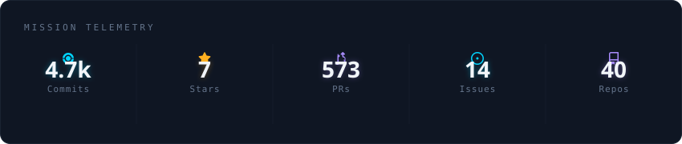

### Afonso Burginski

**Senior Software Engineer** &nbsp;·&nbsp; Video Streaming & Real-Time Media &nbsp;·&nbsp; Distributed Systems & Platform Engineering

7+ years &nbsp;|&nbsp; Backend · Infrastructure · Web · Mobile &nbsp;|&nbsp; Brazil (remote)

---

  

 

  

 

  

 

  

 

<strong>About</strong>

 

I build software systems end to end, with a focus on **video streaming, real-time media and distributed systems**. My strongest work happens at the boundaries between backend, infrastructure, web and mobile: low-latency media workflows, event-driven services, asynchronous processing, and the platforms needed to deploy and operate them reliably.

I care about the decisions behind a system as much as the implementation: performance, scalability, resilience, observability, security, operational complexity and cost.

**What I work with**

- **Media systems:** WebRTC, HLS / LL-HLS, FFmpeg, adaptive bitrate, object storage and CDNs
- **Distributed backend:** NestJS, TypeScript, Kafka, PostgreSQL, Redis / BullMQ, WebSockets, idempotent event processing
- **Platform & operations:** Kubernetes, Docker / Docker Swarm, Argo CD, GitOps, CI/CD, observability
- **Product engineering:** React, Next.js, React Native, Kotlin, Swift
- **AI-assisted engineering:** spec-driven development, coding-agent harnesses, MCP tooling, automated validation and human code review

**Selected work**

- **Stormz+**: video streaming and media pipeline (ingestion, transcoding, adaptive playback, distribution)
- **Orbit**: developer platform for CI/CD and Kubernetes / Docker Swarm delivery
- **Studio**: AI media generation and orchestration platform *(in development)*
- **[nextjs-ffmpeg-transcoder](https://github.com/afonsoburginski/nextjs-ffmpeg-transcoder)**: open source study case on HLS ingestion and transcoding

**Open to** high-impact remote opportunities in streaming / media infrastructure, distributed systems and platform engineering.

 

  
  
  

