**Senior Software Engineer** — Video Streaming & Real-Time Media · Distributed Systems · Platform Engineering

7+ years building backend, infrastructure, web and mobile systems end to end. Based in Brazil, working remotely.

[LinkedIn](https://www.linkedin.com/in/afonsoburginski/) · [Portfolio](https://afonsodev.com) · [Email](mailto:afonsoburginski@gmail.com)

---

## Focus

| Area | What I do | Tools |
|---|---|---|
| **Media & streaming** | Low-latency delivery, ingestion, transcoding, adaptive playback | WebRTC, HLS / LL-HLS, FFmpeg, ABR, object storage, CDNs |
| **Distributed systems** | Event-driven services, async processing, idempotency, reliable state | NestJS, TypeScript, Kafka, PostgreSQL, Redis / BullMQ, WebSockets |
| **Platform engineering** | Delivery pipelines, GitOps, operability | Kubernetes, Docker / Swarm, Argo CD, CI/CD, observability |
| **Product engineering** | Connecting infrastructure decisions to what users actually touch | React, Next.js, React Native, Kotlin, Swift |

## Selected work

| Project | Description | Status |
|---|---|---|
| **Stormz+** | Video streaming and media pipeline: ingestion, transcoding, adaptive playback, storage and distribution | Private |
| **Orbit** | Developer platform for CI/CD and Kubernetes / Docker Swarm delivery | Private |
| **Studio** | AI media generation and orchestration platform | In development |
| [nextjs-ffmpeg-transcoder](https://github.com/afonsoburginski/nextjs-ffmpeg-transcoder) | Open source study case: HLS ingestion, FFmpeg transcoding, Cloudflare R2 delivery | Public |
| [lumi](https://github.com/afonsoburginski/lumi) | Interactive children's storybook app with AI generation, offline-first (Expo + API, bun monorepo) | Public |

## How I work

- **Decisions over stacks.** Performance, resilience, observability, security, operational complexity and cost come before tool choice.
- **Full cycle.** Ownership from architecture and development through delivery and production operation.
- **AI-assisted engineering.** Spec-driven development, coding-agent harnesses, MCP tooling, automated validation and human code review.

## Open to

High-impact remote opportunities in streaming / media infrastructure, distributed systems and platform engineering, including Staff-level technical scope.
