  

  
  
  

I design, build and operate software end to end, with a deep focus on **video streaming and real-time media**, and the **distributed systems and platforms** needed to run them reliably. 7+ years across backend, infrastructure, web and mobile. Brazil · remote.

---

## Case studies

Architecture, trade-offs and results live on the portfolio. Start here:

| Project | What it is | Read |
|---|---|---|
| **Stormz+** | Video streaming and media pipeline: ingestion, transcoding, adaptive playback, storage and distribution | [Case study →](https://afonsodev.com/case-study/stormzplus) |
| **Orbit** | Developer platform: CI to release, GitOps to runtime, on Kubernetes and Docker Compose | [Case study →](https://afonsodev.com/case-study/orbit) |
| **nextjs-ffmpeg-transcoder** | Open source: HLS ingestion, FFmpeg transcoding and Cloudflare R2 delivery | [Case study →](https://afonsodev.com/case-study/nextjs-ffmpeg-transcoder) · [Source](https://github.com/afonsoburginski/nextjs-ffmpeg-transcoder) |
| **Studio** | AI media generation and orchestration platform | In development |

## What I do

| | Area | Depth |
|---|---|---|
| **Specialty** | Video streaming and real-time media | WebRTC, HLS / LL-HLS, FFmpeg, adaptive bitrate, object storage, CDNs |
| **Systems** | Distributed and event-driven backends | NestJS, Kafka, PostgreSQL, Redis / BullMQ, WebSockets, idempotency |
| **Platform** | Delivery and operations | Kubernetes, Docker, GitOps, CI/CD, observability |
| **Product** | Interfaces people actually use | React, Next.js, React Native, Kotlin, Swift |

## How I work

- **Decisions before tools.** Performance, resilience, observability, security, operational complexity and cost come first.
- **Full cycle.** Architecture, development, delivery and production operation.
- **AI-assisted engineering.** Spec-driven development, coding-agent harnesses, MCP tooling, automated validation and human review.

## Stack

  

## Open to

High-impact remote roles in streaming and media infrastructure, distributed systems and platform engineering, including Staff-level technical scope. [Let's talk →](mailto:afonsoburginski@gmail.com)
